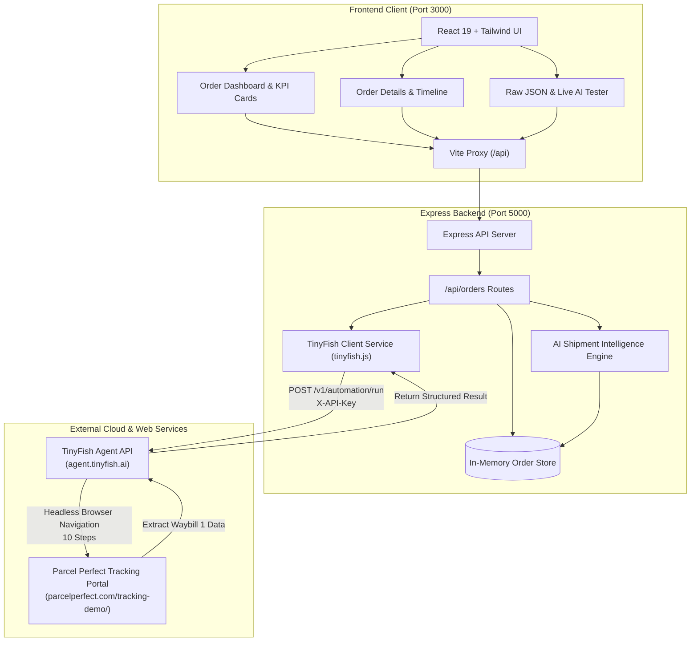

# Orderix — AI-Powered Order & Shipment Intelligence

> A lightweight, modern order management dashboard and proactive shipment intelligence platform built for hackathon demonstration. Orderix integrates with **TinyFish** to automate real-time tracking extraction from public courier tracking portals and runs a deterministic **AI Shipment Intelligence Engine** to catch logistics bottlenecks, SLA delays, and carrier discrepancies before customers are impacted.

---

> [!NOTE]
> **Prototype Status**: Orderix is an MVP developed for hackathon evaluation. While the core architecture, AI intelligence engine, and live TinyFish cloud agent integration are fully functional, this prototype is **not yet production-ready**.

---

## 📑 Table of Contents
1. [Project Introduction](#1-project-introduction)
2. [Problem Statement](#2-problem-statement)
3. [Our Solution](#3-our-solution)
4. [Key Features](#4-key-features)
5. [How TinyFish is Integrated](#5-how-tinyfish-is-integrated)
6. [Technology Stack](#6-technology-stack)
7. [Architecture Diagram](#7-architecture-diagram)
8. [Screenshots](#8-screenshots)
9. [Installation & Setup](#9-installation--setup)
10. [Environment Variable Configuration](#10-environment-variable-configuration)
11. [API Endpoint Documentation](#11-api-endpoint-documentation)
12. [Demo Workflow](#12-demo-workflow)
13. [Current Limitations](#13-current-limitations)

---

## 1. Project Introduction
Managing commercial orders across multiple suppliers and carriers is a major operational headache for logistics teams. **Orderix** bridges the gap between internal order records (Customer Order ID, Supplier Order ID, line items) and live, external courier telemetry. 

Using AI-driven browser agents powered by **TinyFish**, Orderix automates tracking lookups on carrier portals without requiring fragile manual scraping scripts or costly proprietary courier EDI setups. The extracted tracking payload is normalized into a unified 7-field schema and fed through an **AI Shipment Intelligence Engine** that surfaces real-time risk scores and actionable mitigation advice.

---

## 2. Problem Statement
* **Fragmented Carrier Websites**: Different suppliers ship via different couriers (BlueDart, Delhivery, DHL, FedEx, Safexpress, Parcel Perfect). Operators waste hours manually navigating different portals and typing waybills.
* **Silent Bottlenecks**: Shipments often sit at intermediate transit hubs for 48–72 hours without scan events. By the time an operator notices, the promised SLA is broken.
* **Misleading Status Headers**: Carrier headers frequently display *"Delivered"* while the latest scan event reveals the parcel is still sorting at a hub 200 km away.
* **Missing Telemetry**: Public carrier tracking portals often omit Expected Delivery Dates (ETAs), unassigned waybills, or destination stations, preventing automated tracking.

---

## 3. Our Solution
Orderix solves these challenges through:
1. **Single Pane of Glass**: Centralized dashboard uniting Customer Information, Supplier Information, internal order identifiers, and real-time carrier tracking.
2. **Automated Web Agent Extraction**: Live integration with TinyFish enables an AI browser agent to visit public tracking portals, submit waybill numbers, and return clean structured JSON.
3. **Proactive AI Intelligence Engine**: Deterministic rules analyze every tracking payload against 4 operational risk vectors (Stale Updates, Potential Delays, Conflicting Statuses, Missing Info) with composite risk scoring (0–100).

---

## 4. Key Features

### ✅ Implemented Features (Working in MVP)
* **Real-Time KPI Dashboard**:
  * Dynamic counters for **Total Orders**, **Processing Orders**, **Dispatched Orders**, and **Potentially Delayed Orders**.
  * Instant category filtering (All, Processing, Dispatched, Stale Updates, Delayed ETA, Conflicting Status, Missing Info).
  * Global real-time search across Customer Order IDs, Supplier Order IDs, Customer Names, Suppliers, and Waybill numbers.
* **Comprehensive Order Details View**:
  * Customer card (Contact name, company, email, phone, full shipping address).
  * Supplier card (Supplier name, dispatch contact lead, origin warehouse, internal SKU).
  * Linked Customer Order ID (e.g., `ORD-2026-PP01`) and Supplier Order ID (e.g., `SUP-PP-SANDBOX`).
  * Shipment Information card displaying carrier, waybill number, origin, destination, current location, latest tracking update, and ETA.
  * Interactive chronological tracking milestone timeline with checkpoint status tags.
* **AI Shipment Intelligence Module**:
  * **Stale Tracking Updates**: Flags scan blackouts ($>36$h warning, $>60$h critical dock search escalation).
  * **Potentially Delayed Shipments**: Flags overdue ETAs, high-velocity bottlenecks ($<24$h to ETA but stranded at origin), and carrier exception events.
  * **Conflicting Status Information**: Catches state desynchronization (e.g., header says *"Delivered"* while scan history shows *"Awaiting Sorting"*).
  * **Missing Delivery Information**: Flags unassigned waybills, missing ETAs, or blank destination hubs.
  * Composite Risk Score (0–100) and risk priority levels (`LOW`, `MEDIUM`, `HIGH`, `CRITICAL`).
* **Live TinyFish Agent Integration**:
  * Authenticated connection to the official TinyFish Agent API (`https://agent.tinyfish.ai/v1/automation/run`).
  * Verified live execution against the **Parcel Perfect Sandbox** using **Waybill `1`**.
  * Dynamic, single-page state update without page refreshes.
  * Live verified badge displayed only after verified cloud extraction with run ID and step counts.
* **Interactive Tooling & Inspection**:
  * Raw JSON inspector modal showing exact structured extracted payloads.
  * Live AI Intelligence tester allowing operators to paste arbitrary tracking JSON and run diagnostics on-demand.

### 🔮 Planned Features (Future Roadmap)
* Persistent database layer (PostgreSQL with Prisma ORM) replacing the current in-memory store.
* Automated webhook listeners for push-based carrier updates.
* Automated email / SMS alerts dispatched to customers when high-risk delay flags are triggered.
* Multi-courier credential vault integration for private carrier accounts.

---

## 5. How TinyFish is Integrated

TinyFish is integrated as an external AI web automation service:

1. **Authentication**: Uses `process.env.TINYFISH_API_KEY` loaded securely via `dotenv` from `server/.env`. The key is never exposed to frontend code, client bundles, logs, or Git.
2. **Service Module ([`server/src/tinyfish.js`](file:///c:/Users/princ/OneDrive/Documents/Orderix/server/src/tinyfish.js))**:
   * Calls the synchronous endpoint: `POST https://agent.tinyfish.ai/v1/automation/run`.
   * Sends the target portal URL (`https://parcelperfect.com/tracking-demo/`) and natural language goal.
3. **Execution**:
   * TinyFish spawns a cloud browser session in an isolated microVM.
   * The agent navigates the tracking portal, inputs the waybill number (e.g., `1`), and triggers tracking.
   * Reads the tracking results and returns the execution payload.
4. **Normalization & Intelligence Hook**:
   * The backend parses the agent output into the standardized 7-field schema.
   * Attaches live metadata (`runId`, `durationSeconds`, `stepsCount`).
   * Passes the updated shipment directly into `analyzeShipmentIntelligence()`.
   * Pushes the live data to the frontend in a single response.

---

## 6. Technology Stack

* **Frontend**:
  * **React 19** + **Vite 8**
  * **Tailwind CSS v4** (Modern styling with `@tailwindcss/vite`)
  * **Lucide React** (Vector iconography)
  * **Vite Reverse Proxy** (Direct `/api` proxy to backend port 5000)
* **Backend**:
  * **Node.js (v24)** (ES Modules architecture)
  * **Express 4.21** (REST API)
  * **CORS** & **Dotenv** (Middleware and secure environment handling)
* **External AI Automation**:
  * **TinyFish Agent API** (`agent.tinyfish.ai`)
* **Testing & Verification**:
  * **Puppeteer Core** (Automated headless browser end-to-end verification)

---

## 7. Architecture Diagram



---

## 8. Screenshots

> Screenshots captured from the live application during verification. Place real images in `docs/screenshots/`.

### 1. Orderix Overview Dashboard
*Displays real-time KPI metrics, AI risk category filter pills, and active order stream with risk tags.*


---

### 2. Order Details & Chronological Timeline
*Deep-dive view showing Customer Information, Supplier Information, Carrier Attributes, and Event Milestones.*


---

### 3. Live TinyFish Web Agent Execution
*Verified live extraction from the Parcel Perfect sandbox (Waybill 1) displaying Run ID and execution duration.*


---

### 4. AI Shipment Intelligence Diagnostic
*Risk breakdown covering Stale Tracking Updates, Potential Delays, Status Conflicts, and Missing Delivery Info.*


---

## 9. Installation & Setup

### Prerequisites
* **Node.js** v20+ or v24+
* **npm** v10+
* A valid **TinyFish API Key** from [agent.tinyfish.ai/api-keys](https://agent.tinyfish.ai/api-keys)

### 1. Clone & Install Dependencies
From the project root:
```bash
# Install root orchestration packages
npm install

# Install client packages
npm --prefix client install

# Install server packages
npm --prefix server install
```

### 2. Configure Environment Variables
Create a `.env` file inside the `server/` directory:
```bash
# server/.env
TINYFISH_API_KEY=your_actual_tinyfish_api_key_here
PORT=5000
```

> [!IMPORTANT]
> Never commit `server/.env` to Git. Both root `.gitignore` and `server/.gitignore` exclude `.env` automatically.

### 3. Run Development Servers
From the project root, run both servers concurrently:
```bash
npm run dev
```

* **Frontend Application**: `http://localhost:3000`
* **Backend API**: `http://localhost:5000`
* **Backend Healthcheck**: `http://localhost:5000/api/health`

---

## 10. Environment Variable Configuration

| Variable | Location | Required | Description |
|---|---|---|---|
| `TINYFISH_API_KEY` | `server/.env` | **Yes** | Your API key for TinyFish Agent API (`https://agent.tinyfish.ai`). Used to authenticate live web agent runs. |
| `PORT` | `server/.env` | No | Express server port (defaults to `5000`). |

---

## 11. API Endpoint Documentation

| Method | Endpoint | Query / Body Params | Description |
|---|---|---|---|
| `GET` | `/api/health` | None | Returns backend status, mode, and TinyFish connectivity state. |
| `GET` | `/api/orders` | `?status=...&filterType=...&search=...` | Retrieves all orders enriched with AI intelligence scores and KPI metrics. |
| `GET` | `/api/orders/:id` | None | Retrieves a single order by ID or Customer Order ID with full timeline and diagnostic. |
| `GET` | `/api/orders/tinyfish/status` | None | Confirms whether `TINYFISH_API_KEY` is loaded and ready without exposing the key. |
| `POST` | `/api/orders/tinyfish/track` | `{ waybillNumber, trackingUrl, carrier, orderId }` | Triggers live TinyFish cloud web agent to scrape tracking details and updates the order. |
| `POST` | `/api/orders/intelligence/analyze` | Raw tracking JSON payload | Runs on-the-fly AI Shipment Intelligence analysis on any arbitrary payload. |

---

## 12. Demo Workflow

Follow these steps for presentation and judge evaluation:

1. **Open Dashboard**: Visit `http://localhost:3000`. Observe the KPI cards (Total: 9, Processing: 2, Dispatched: 7, Delayed: 4).
2. **Review Initial State**: Find the preloaded sandbox order **`ORD-2026-PP01`** at the top of the table. Notice it begins in demo test state without a live badge.
3. **Open Order Details**: Click on order `ORD-2026-PP01`. Review customer details (*Liam Botha, Cape Town*), supplier details (*Gauteng Industrial Spares*), and initial waybill `1`.
4. **Trigger Live TinyFish Sync**: Click **"Track Live with TinyFish"**.
5. **Watch Real-Time Execution**: The button enters its loading state (*"TinyFish Agent Navigating Portal..."*). In the cloud, TinyFish navigates `https://parcelperfect.com/tracking-demo/` and tracks Waybill `1`.
6. **Observe Dynamic Update**: Without refreshing the page, the status updates to *"Delivered"*, current location updates to *"Cape Town Delivery Hub (CPT)"*, the **`LIVE TINYFISH VERIFIED`** badge appears, and the AI Intelligence diagnostic recalculates to **`LOW RISK` (22/100)**.
7. **Inspect Extracted JSON**: Click **"Inspect Extracted JSON"** to view the structured 7-field payload returned by TinyFish.
8. **Test Anomaly Engine**: Switch to the **"Live AI Intelligence Tester"** tab inside the modal and click **"Run AI Shipment Intelligence"** to see how the engine flags delays, stale checkpoints, and status conflicts.

---

## 13. Current Limitations

* **In-Memory Storage**: Orders are maintained in server memory initialized from demo datasets; restarting the server resets any dynamic modifications.
* **Agent Latency**: Synchronous browser execution via TinyFish takes between 50 to 100 seconds depending on carrier website responsiveness.
* **Carrier Bot Protections**: Public carrier websites with aggressive Cloudflare Turnstile or reCAPTCHA challenges may require elevated TinyFish stealth browser profiles.
* **Non-Production Prototype**: Built specifically as a hackathon MVP demonstration; production hardening (OAuth, multi-tenant databases, rate limiters) is planned for future phases.
